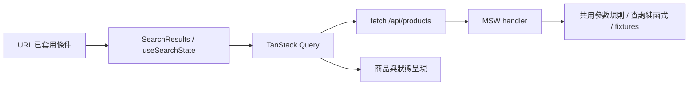

# momo 搜尋頁 Take-home

題目 A「Mocking momoshop」的純前端實作，聚焦一個可驗證的搜尋流程。以固定 Mock 資料與本地圖片呈現 momo 搜尋頁，不呼叫真實網站 API。

## 實作範圍與完成定義

主要路由為 `/search/`，`/` 僅提供搜尋入口。完成「輸入 → 套用條件 → 顯示結果 → 清除／還原 → 錯誤復原」的閉環：

- 關鍵字搜尋、單層分類與品牌單選／取消、價格區間、綜合推薦／價格升降序、每頁 12 筆的分頁。
- 分類與品牌選項依目前條件動態產生，保留可移除的已選條件，包含零結果情境。
- URL 支援 `q / category / brand / min / max / sort / page`；直接進入、重新整理、返回與前進後，控制項與商品一致。
- 價格草稿驗證、載入、無結果、API 失敗及手動重試；非法 URL 與超界頁碼會修正。
- 桌面六欄、窄螢幕基本重排；24 筆固定商品、六張本地商品圖片。

刻意不做：完整首頁、商品詳情、會員／購物車／結帳、完整分類樹、品牌系列、進階服務篩選、其他排序、即時搜尋、momo 手機站還原及真實後端。商品卡與導覽文字不偽裝成未實作的功能連結。

## 啟動與重現

需求：Node.js **24.21.0**（`.nvmrc`）、pnpm **8.8.0**（`packageManager`）。

```sh
nvm use
pnpm install --frozen-lockfile
pnpm dev
```

開啟 <http://localhost:3000/search/?q=手機>。可操作「手機 → 手機配件 → HODA」，結果應為 **24 → 16 → 8** 筆；選取後按 × 可取消。

直接開啟 `/search/?q=iphone&brand=HODA&min=1000&max=1800&sort=price-desc`，應顯示四件商品，價格為 **1,790、1,690、1,590、1,490**。

```sh
pnpm typecheck
pnpm lint
pnpm test
pnpm build
pnpm preview
```

`build` 產生 `out/`，`preview` 提供靜態檔案；不使用 `next start`。可將 `out/` 部署至 HTTPS 靜態主機，本機以 localhost／loopback HTTP 即可啟用 Service Worker。執行時沒有 Node API server。

## App 架構與狀態責任



| 位置                    | 責任                                                  |
| ----------------------- | ----------------------------------------------------- |
| `src/app`               | 路由、Metadata、Suspense 與 Providers                 |
| `src/features/search`   | 容器與 URL 導航；`components/` 只接收 props／callback |
| `src/features/products` | 商品型別、HTTP 呼叫、查詢規則、商品卡與單元測試       |
| `src/mocks`             | 固定資料、MSW handler、瀏覽器 Worker 啟動             |
| `public`                | 本地圖片與產生的 Worker 腳本                          |
| `e2e`                   | 以實際瀏覽器驗證搜尋流程                              |

已套用條件以 **URL 為單一來源**；未送出的搜尋／價格文字留在 Local State；結果、載入／錯誤與快取由 Query 管理。Mock 層重用產品查詢規則，不反向依賴 React 元件。

## 技術選擇與 Tradeoff

| 選擇                             | 原因與代價                                                                                                                                                                      |
| -------------------------------- | ------------------------------------------------------------------------------------------------------------------------------------------------------------------------------- |
| Next.js App Router＋TypeScript   | 使用熟悉的路由與元件工具，以靜態輸出符合純前端需求。商品在瀏覽器載入，本次不提供 SSR 商品內容或真實電商 SEO。                                                                   |
| Tailwind CSS＋CSS Grid           | 快速對照參考圖與建立響應式排列，不為單頁再引入 UI 套件。                                                                                                                        |
| TanStack Query                   | 依完整查詢條件快取結果，集中管理 data／loading／error，避免再加入一份 App Store。固定 Mock 使用無限 stale time、停用自動重試與焦點 refetch；真實 API 須重新決定過期及失效策略。 |
| MSW                              | App 使用一般 fetch，呼叫端agnostic；之後可替換 API 地址而保留資料流程。代價是 Worker 啟動等待與環境設定。                                                                       |
| 原生 URLSearchParams＋Next hooks | 七個查詢參數可用共用純函式明確處理，暫不新增 nuqs、Zod 或 Zustand。schema 成長時再重評。                                                                                        |
| Vitest                           | 在 Node 環境快速驗證數值、查詢、排序與分頁邊界；不將純函式測試當成 UI 已接線的證明。                                                                                            |
| Playwright                       | 對建置後的靜態網站驗證實際 UI、URL、Query 與 MSW 的整合，並保留失敗證據。時間內限定一個桌面瀏覽器，不建立完整跨瀏覽器矩陣。                                                     |

搜尋與價格在送出時套用，其他條件改變時回到第一頁；清除篩選保留關鍵字。一般導航使用 `push`，正規化使用 `replace`。同價商品以 ID 排序，確保固定結果。

Facets 採全部已套用條件的交集（Conjunctive Faceting），只列出有效選項；移除選取後可重新選擇。沒有完整階層分類。URL 改變時重置內層容器的草稿，實作較簡單，但未保留輸入焦點與未送出的草稿；新查詢先顯示載入狀態，不以舊商品作 placeholder。

## Mock 與素材

開發與靜態展示版皆啟用 MSW，等待 `worker.start()` 完成才掛載查詢元件，避免首次請求穿透至不存在的 API。Worker 啟動失敗會顯示重新載入入口。

固定商品的價格、組合、評分及優惠均為示範資料；關鍵字以名稱、品牌與 keywords 做基本 token 比對，沒有搜尋引擎的斷詞、模糊搜尋或排序模型。六張代表性圖片原樣下載至本地，見 [素材來源](docs/asset-sources.md)。更新 MSW 後執行 `pnpm exec msw init public --save` 同步 Worker 腳本。

## 測試與交付證據

- **51 個 Vitest 案例**：URL 編碼／正規化、價格邊界、分類／品牌連動、Facet 計數、排序、分頁與輸入不變性。預期值獨立指定，不以被測函式產生答案。
- **5 個 Playwright E2E**：組合查詢；分類／品牌與清除；分頁、直接 URL、重新整理及歷史還原；非法價格與零結果復原；API 失敗後重試。
- E2E 保留實際 MSW handler，不以測試寫死的成功回應繞過業務規則；僅錯誤案例注入一次 503，重試時回到真實 MSW 流程。每個案例監看未處理 JS 例外與外部 HTTP 請求。

```sh
# 標準 Playwright Chromium
pnpm exec playwright install chromium
pnpm test:e2e

# 本機已有 Google Chrome 時，可免下載 Chromium
PLAYWRIGHT_CHANNEL=chrome pnpm test:e2e

# 開啟報告；開發時也可執行 pnpm test:watch
pnpm test:e2e:report
```

`test:e2e` 先 build，再由 Playwright 在 **4173** 啟動獨立靜態伺服器，與開發使用的 3000 分開；測試後自動停止。失敗保留 trace 與截圖，HTML report 與執行產物不納入 Git。此次實際驗證環境為 macOS＋本機 Chrome，標準 Chromium／其他瀏覽器未另跑。

視覺證據：[使用者提供的參考圖](docs/reference/search-reference.png)、[桌面](docs/implement-steps/assets/02-desktop.png)、[窄螢幕](docs/implement-steps/assets/02-mobile.png)、[目前分類與品牌流程](docs/implement-steps/assets/03-category-filters.png)。較早截圖為當時階段成果；目前行為以測試與最後一張流程圖為準。

## 與真站的差異

本作業保留搜尋頁的主要視覺結構、資訊層級與操作閉環；不宣稱 pixel-perfect。Mock 僅有手機／手機配件及四個品牌，語料有限；真站的分類階層、品牌系列、動態進階屬性與大量活動模組未實作。縮減篩選列也使商品區較早出現。搜尋 URL 使用 query string，不複製原站的完整 URL 編碼方式。

## AI 協作方式與判斷證據

採 **單一 Codex Agent＋人工 review**，每批先確認 scope／驗收與重要技術選擇，再實作、驗證、寫紀錄，等使用者核可才 commit。提交依依賴關係拆成小型 Conventional Commits，保留 Codex co-author trailer；實際提交時間未回填成實作時間。

使用者負責範圍、技術偏好與真站行為 review；AI 負責提出方案、實作、測試及揭露限制。具體迭代包括：

1. 使用者選擇 MSW，AI 記錄相較本地 Promise service 的啟動成本與 HTTP 邊界優點。
2. 使用者要求容器／呈現元件分工，將搜尋子元件移入 `components/`。
3. 初版 45 個測試通過，但使用者對照真站指出分類只有摘要、Facet 選項未真正收斂。AI 實際操作真站後修正規則與 UI，補至 51 個案例。這說明測試通過不能取代需求驗證。
4. E2E 第一輪發現 Next.js 路由公告與產品錯誤訊息共用 alert role；依 trace 將定位限於主內容，沒有修改產品行為來遷就測試。

效率取捨是先保住可交付的單頁與驗證，延後其他路由、進階 Facets、RTL 及跨瀏覽器矩陣。多次人工停點增加 review 成本，但也及早攔下範圍與語意問題；沒有為了展示多 Agent 而增加整合成本。

規劃與實作／review 時間見 [Plan](docs/search-page-plan.md)、[01 建置](docs/implement-steps/01-project-foundation.md)、[02 視覺](docs/implement-steps/02-search-page-ui.md)、[03 查詢](docs/implement-steps/03-search-query.md)、[04 交付驗證](docs/implement-steps/04-delivery-validation.md)。各批時間為紀錄的近似值，評估可搭配 Git 真實時間閱讀。

## 後續演進方向

| 觸發條件               | 下一步                                                                                 |
| ---------------------- | -------------------------------------------------------------------------------------- |
| 作為長期維護專案       | CI 執行 frozen install、lint、typecheck、Vitest、build 與 Playwright，保存失敗報告。   |
| 接入真實 API           | 保留 fetch 邊界，加入回應 schema 驗證、快取失效與錯誤分類，移除展示用 MSW 啟動流程。   |
| 擴大分類與商品語料     | 引入穩定分類 ID／階層與可配置 Facet schema，再評估搜尋服務、分詞與相關性排序。         |
| 提升正式產品體驗       | 保留輸入焦點、降低載入版面跳動，補 Worker 啟動失敗、慢請求／競態、鍵盤與跨瀏覽器測試。 |
| 真實電商 SEO／流量需求 | 重新評估 SSR／預渲染、圖片最佳化與效能監測，不因使用 Next.js 就假設這些已完成。        |

依題目，本次優先交付範圍閉環、可重跑驗證、真站差異與人工決策證據。下一個最值得補強的是 CI 與上述操作穩定性，而非增加商品頁或購物車。
